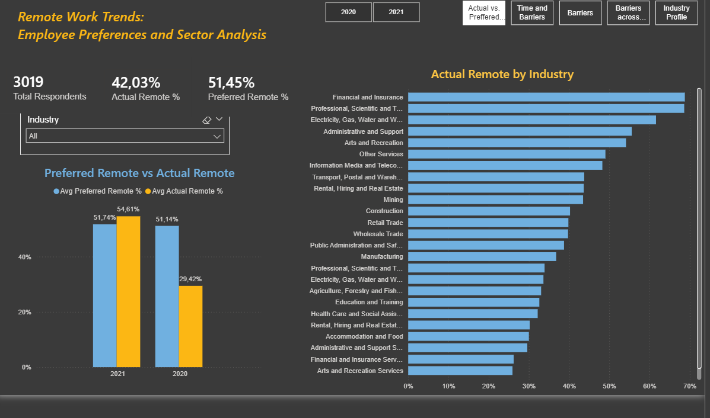
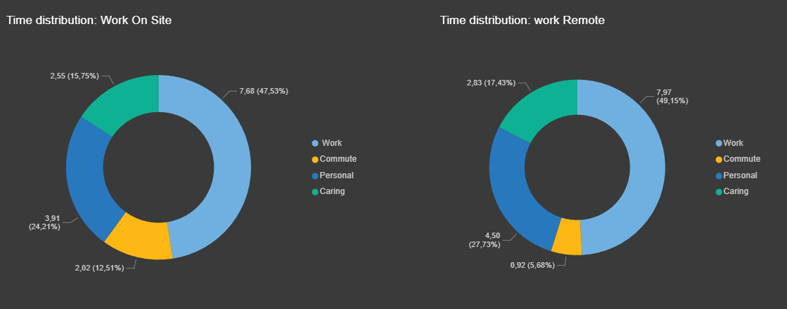
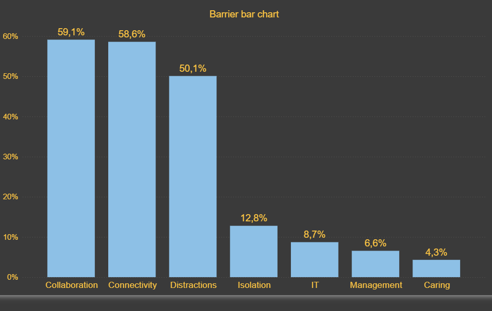

# Remote Work Analytics | Power BI

**Interactive dashboard | Data Analytics final project | DAN.IT Education, 2026**

## Project overview

This Power BI project explores survey responses from **2020–2021** to compare actual and preferred remote-work arrangements, examine differences between industries, analyze time allocation, and identify barriers to working remotely.

The goal was to turn survey data into a navigable report where users can explore differences across years, industries, and respondent groups rather than relying on a single static chart.

## What I worked on

- Imported and transformed survey data for analysis in Power BI.
- Built a multi-table data model with relationships and created DAX measures for KPIs and comparisons.
- Created interactive visuals with slicers and navigation between report pages.
- Examined actual versus preferred remote work, workplace barriers, industry differences, and time allocation.
- Published the course report in Power BI Service and prepared a mobile layout.

**Tools:** Power BI Desktop, Power Query, DAX, data modelling, Power BI Service.

## Report screenshots

### Actual vs. preferred remote work and industry breakdown

### Time allocation: on-site vs. remote

### Reported barriers to remote work

The `.pbix` file contains the full interactive report with additional pages for barriers by industry, demographic comparisons, and industry profiles.

## Selected findings

The figures below are **descriptive results from the survey/report**; they do not establish causation.

- Across the displayed sample (**3,019 respondents**), the dashboard shows **42.03% actual remote work** versus **51.45% preferred remote work**.
- In the chart comparing years, reported actual remote work is **29.42% in 2020** and **54.61% in 2021**. The preferred level is about **51%** in both years. These figures describe the displayed data and filters; they should not be interpreted as a causal time trend.
- The most frequently reported barriers in the displayed visualization are **collaboration (59.1%)**, **connectivity (58.6%)**, and **distractions (50.1%)**.
- The report compares allocation of work, commuting, personal, and caring time between on-site and remote work, with industry-level breakdowns available interactively.

## Repository contents

- `Remote_Work_Analytics.pbix` — original interactive Power BI report and model.
- `screenshots/` — three images extracted from the original final-project presentation.

## Context and limitations

This is an **educational capstone project**, not a production dashboard for an employer. Findings depend on the underlying survey, its sampling, filters, and respondents. The screenshots are static examples; the full PBIX file provides the interactive experience in Power BI Desktop.

The original data-source citation should be added when its precise publication link has been verified. Please verify redistribution permissions for embedded survey data before sharing the PBIX publicly.
